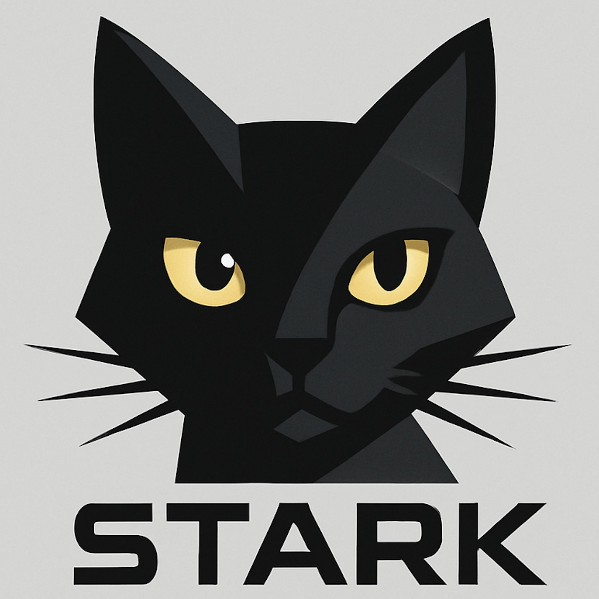

<p align="center">
  
</p>

<h1 align="center">Stark</h1>

<p align="center">
  <strong>Native inference on Apple silicon.</strong><br>
  Rust and Metal for local generation, probability scoring and model preparation.
</p>

<p align="center">
  <a href="#quickstart">Get started</a> ·
  <a href="#supported-model-families">Models</a> ·
  <a href="#measured-performance">Benchmarks</a> ·
  <a href="#developing-stark">Developers</a> ·
  <a href="docs/README.md">Documentation</a> ·
  <a href="https://starkengine.app/">Website</a>
</p>

Stark is an experimental, open-source Rust/Metal engine for running language models locally on Apple silicon. It provides a menu bar app, terminal chat, a loopback OpenAI-style API, probability scoring and model conversion. Applications can also drive its native workers directly through private stdin/stdout pipes with one JSON request and reply per line.

| Generate | Score | Prepare |
| --- | --- | --- |
| Terminal chat and native text generation, with exact reuse of the prompt prefix shared by consecutive requests. | Candidate logits, full-vocabulary log probabilities and temperature-scaled candidate probabilities. | Streaming conversion of supported dense and existing MLX 4/8-bit checkpoints. |
| [Generation protocol](docs/GENERATION.md) | [Scoring protocol](docs/SCORING.md) | [Converter guide](tools/converter/README.md) |

## Quickstart

Use an **Apple silicon Mac with macOS 26.4 or newer** in a native arm64 terminal. The [latest signed release](https://github.com/jshahbazi/stark/releases/latest) includes the menu bar app, terminal chat, both workers, the converter and private Python runtimes; no source checkout or developer tools are needed.

### Install the app

Download the signed, notarized `.dmg` from the [latest release](https://github.com/jshahbazi/stark/releases/latest) and open **Install Stark** when included. It replaces the running copy and launches the new app. Older DMGs use drag-and-drop: copy `Stark.app` into Applications, quit the old app, then open the installed copy. Click the cat icon, select **Beginner**, then **Guided setup**. Choose a task, review the model recommendation for your Mac, and follow the steps to download, start and chat with the model. The guide can also help connect OpenWork. To choose your own model and settings, select **Advanced** and open **Manage Models**; **Model Catalog** and **Add from Source** remain available. Both interfaces share installed models. [Menu bar guide](apps/menu-bar/README.md)

### Install the app and terminal tools

```sh
curl -fL https://github.com/jshahbazi/stark/releases/latest/download/install.sh -o stark-install.sh
sh stark-install.sh
export PATH="$HOME/.local/bin:$PATH"
stark doctor
open "$HOME/Applications/Stark.app"
```

The script installs the CLI under `~/.local` and the app under `~/Applications` without sudo and checks the archive checksum before activating anything. Add the `PATH` line to `~/.zprofile` to keep `stark` available. The DMG and the in-app updater verify code signatures; the script checks a checksum from the same release. See [installation](docs/INSTALLATION.md), including [what each route verifies](docs/INSTALLATION.md#what-each-install-route-verifies).

### Chat in Terminal

```sh
stark convert Qwen/Qwen3-0.6B --output models/qwen3
stark chat --model-path "$PWD/models/qwen3"
```

Conversion downloads the model; use a new output directory each time. Chat loads it: one message per line, `/reset` clears history, `/exit` quits. See [chat options](docs/GENERATION.md#interactive-cli-chat).

### Use Stark from another app

Stark serves an OpenAI-style chat API for clients on the same Mac. Run a model in Chat mode, open **Connections** from Stark's menu, and use **Apps** to connect OpenWork or OpenCode Desktop without copying a key. For other native clients, choose **Connect your own app** and copy the **Base URL**, **API key** and **Model ID** into an OpenAI-compatible provider. The master key persists in macOS Keychain until you explicitly regenerate it. Streaming is supported. Qualified models and templates can return validated function calls for the client to execute under its own approval policy; Stark does not execute functions. Browser-origin requests, remote devices, embeddings and structured output are unsupported. See the [local API contract](docs/LOCAL_API.md) and [tested clients](docs/LOCAL_API.md#client-compatibility).

The [native image path](docs/MULTIMODAL_IMPLEMENTATION.md) accepts one PNG/JPEG through Playground, terminal chat and the Local API. This source branch adds quantized Qwen dense/MoE, retained Lily Flash-Next, Gemma 3 and Gemma 4 image paths alongside dense Qwen3.5 BF16. Image artifacts require compatible tensors and reviewed metadata, native admission, and automatic local checks. See the [coverage and validation record](docs/archive/runs/2026-11-07-image-family-integration.md) for exact checkpoints, builds and remaining limits. Installed releases can have an earlier capability set.

## Models and application integration

### Supported model families

The tables below include named checkpoints and fine-tunes as well as their implementation families. Braces abbreviate size or version choices, such as `Qwen3-{0.6B,1.7B}`.

#### Text

| Family / adapter | Named models and checkpoint coverage |
| --- | --- |
| **Qwen3.8-Flash-Next** | Prepared native-source `pipenetwork/Qwen3.8-Flash-Next-MLX-mixed-4_8bit` and `fabiogreter/Qwen3.8-Flash-Next-lily-q4-xl`; typed Uzu text conversion is checked against the pinned Lily checkpoint for readout and sampled-generation parity |
| **GLM-5.3-Flash** | `unsloth/GLM-5.3-Flash-GGUF` (`UD-Q2_K_XL`) |
| **Recursive Flint** | `RecursiveSI/flint-int4` |
| Qwen3 dense | `Qwen/Qwen3-{0.6B,1.7B,4B,8B,14B,32B}`, `Qwen/Qwen3-4B-Instruct-2507`, `Qwen/Qwen3-4B-Thinking-2507`, **Polaris-4B-Preview** (`POLARIS-Project/Polaris-4B-Preview`) |
| Qwen2 dense | **Qwen2.5-Coder** (`Qwen/Qwen2.5-Coder-{0.5B,1.5B,3B,7B,14B,32B}-Instruct`), **DeepSeek-R1-Distill-Qwen-1.5B** (`deepseek-ai/DeepSeek-R1-Distill-Qwen-1.5B`) |
| Qwen3.5 dense | `Qwen/Qwen3.5-{0.8B,2B,4B,9B,27B}`, **Qwen3.8-4B-Distill** (`empero-ai/Qwen3.8-4B-Distill`), **JevK5** (see Decision below), **Qwen3.8-27B oQ4e MTP** (`Jundot/Qwen3.8-27B-oQ4e-mtp`, mixed 4/5/6/8-bit with a quantized MTP head) |
| Llama dense | `meta-llama/Llama-3.1-8B-Instruct`, `meta-llama/Llama-3.2-{1B,3B}-Instruct`, `unsloth/Llama-3.2-1B-Instruct`, **SmolLM2** (`HuggingFaceTB/SmolLM2-1.7B-Instruct`), **Nanbeige4.1** (`Nanbeige/Nanbeige4.1-3B`), **Reka Flash 3.1** (`RekaAI/reka-flash-3.1`) |
| Mistral dense | **Mistral 7B Instruct** (`mistralai/Mistral-7B-Instruct-{v0.2,v0.3}`), **Codestral** (`mistralai/Codestral-22B-v0.1`), **Devstral Small** (`mistralai/Devstral-Small-2505`) |
| Gemma 2 | `google/gemma-2-2b-it` |
| Gemma 3 text | `google/gemma-3-1b-it`, **FunctionGemma** (`google/functiongemma-270m-it`), **rnj-1** (`EssentialAI/rnj-1-instruct`) |
| OLMo 3 | Pinned `allenai/Olmo-3-7B-Instruct` BF16 and MLX affine imports; [source-bound validation](docs/OLMO3_GEMMA4.md) |
| Gemma 4 | Pinned E2B/E4B PLE and 31B no-PLE decoder layouts; [formats and qualification limits](docs/OLMO3_GEMMA4.md) |
| Phi-3 layout | **Phi-4-mini-instruct** (`microsoft/Phi-4-mini-instruct`); supported tied-embedding layout with LongRoPE |
| Granite dense | `ibm-granite/granite-{3.1,3.3}-{2b,8b}-instruct` |
| SmolLM3 | `HuggingFaceTB/SmolLM3-3B` |
| LFM2 | `LiquidAI/LFM2-{350M,700M,1.2B,2.6B}` |
| LLaMBA / Mamba2 | `cartesia-ai/Llamba-1B`, `cartesia-ai/Llamba-1B-4bit-mlx` |

For models using the converter, supported floating Safetensors layouts produce native BF16 artifacts. Existing MLX affine 4/8-bit exports are also supported for Qwen3, Qwen3.5, Lily-format Qwen3.8 text, Llama, Gemma 3 text, SmolLM3, LFM2 and LLaMBA, subject to each adapter's layout and group-size constraints. The [converter coverage table](tools/converter/README.md#catalog-coverage-and-qualification) lists the registered export names. Compatible complete checkpoints and merged fine-tunes can use generic conversion even when absent from the catalog.

Qwen3.8-Flash-Next, GLM-5.3-Flash and Flint use native Rust/Metal paths for prepared quantized checkpoints. Use the [pinned preparation commands](docs/NATIVE_HYBRID_MODELS.md); see [Flint setup and limits](docs/FLINT.md). Lily-format Qwen3.8 also converts to a self-contained typed Uzu text artifact with canonical MLX storage and the same specialized Qwen kernels. It preserves quantization and omits vision and MTP. The [Uzu-format study](docs/benchmarks/QWEN38_UZU_FORMAT_2026_10_29.md) records exact readout and sampled-generation controls for the pinned artifact. These text paths are separate from the retained Lily image path below.

The dense `Jundot/Qwen3.8-27B-oQ4e-mtp` checkpoint uses the converted Qwen3.5-family path, retaining its mixed affine precision and complete quantized MTP predictor. It is separate from Qwen3.8-Flash-Next. See [preparation and admission](tools/converter/README.md#dense-qwen38-27b-oq4e-mtp) and the [packed-weight validation follow-up](docs/benchmarks/2026-11-06-qwen38-27b-packed-followup.md).

#### Images

| Family / model | Image support in Stark |
| --- | --- |
| **Qwen3.5 dense BF16** | Complete compatible checkpoints and merged fine-tunes use the configuration-driven family contract. The recorded 0.8B artifact has reference and execution evidence; other artifacts need their own checks. |
| **Qwen3.5 / dense Qwen3.8 with quantized decoders** | Complete BF16 vision tower plus admitted affine decoder storage. The pinned Qwen3.5 0.8B 4-bit cases match source logits exactly; `Jundot/Qwen3.8-27B-oQ4e-mtp` passes recorded tower and worker lifecycle checks. |
| **Qwen3.5 MoE** | The pinned quantized 35B-A3B artifact passes tower and worker lifecycle checks. The separate BF16-source MoE path has controlled component checks; full 35B execution is unverified. |
| **Retained Qwen3.8-Flash-Next Lily** | The pinned `fabiogreter/Qwen3.8-Flash-Next-lily-q4-xl` image artifact passes a full 27-layer vision comparison and worker lifecycle checks. Typed text-only Lily conversions omit the tower. |
| **Gemma 3 multimodal BF16** | Original 4B/12B/27B profiles. The pinned 4B has reference and worker/API evidence; full 12B/27B execution is unverified. |
| **Gemma 4 BF16** | Pinned E2B/E4B/12B/26B-A4B/31B profiles. E2B/E4B have execution evidence; 12B embedder, 26B MoE and 31B tower have component checks. Full 12B/26B/31B generation is unverified. |
| **GLM-5.3-Flash, Flint and recorded JevK5 artifact** | These paths remain text-only. Other families require a separately implemented image contract. |

Image input supports one PNG/JPEG through Playground, terminal chat and the Local API. Convert supported non-retained checkpoints with `--artifact-mode vision-language`; the default text conversion omits vision tensors. Retained Lily uses its [family-specific preparation path](docs/archive/runs/2026-11-07-qwen-image-families.md#original-format-flash-next). Supported quantized decoder storage still requires a complete BF16 vision tower. Quantized vision-tower weights and LoRA-only adapters are unsupported. Images clear prefix reuse and keep MTP off. A family name alone does not qualify a checkpoint; see the [family contracts](docs/VISION_FAMILY_CONTRACT.md) and [validation matrix](docs/archive/runs/2026-11-07-image-family-integration.md).

#### Decision

| Model | Supported use | Images |
| --- | --- | --- |
| **JevK5** (`alibiserikbay/JevK5`, BF16 Qwen3.5-4B) | Candidate probability scoring and the app's Decision workflow. [Recorded scoring parity](docs/validation/SCORING_PARITY.md) covers 243 cases on its named build; [chat EOS checks](docs/TERMINATOR_METRICS_VALIDATION_2026_10_25.md) also cover native generation. | The recorded JevK5 artifact is text-only. |

The [scoring worker](docs/SCORING.md) can also score compatible language models listed under Text. Decision use requires a direct-answer template, distinct single-token labels and checkpoint-specific checks. JevK5's recorded parity applies to its exact checkpoint and build; decision accuracy and calibration need their own evaluation.

Family support describes implemented code paths. Each checkpoint needs compatible metadata and tensors and a successful native load; quality, throughput and Decision calibration require separate validation. These are source-tree capabilities; installed releases may contain an earlier set of families.

The [converter guide](tools/converter/README.md#catalog-coverage-and-qualification) details formats and checkpoint coverage. Existing supported MLX 4/8-bit weights are repacked without requantization. For a complete downloaded or merged fine-tuned checkpoint:

```sh
stark convert /absolute/path/to/checkpoint --metadata-profile hf-generic \
  --offline --output models/local-model
```

The folder needs complete safetensors weights, config, tokenizer, chat template and end-of-sequence metadata; merge LoRA/PEFT adapters first. A successful conversion checks the layout, not inference quality. See [future checkpoints](tools/converter/README.md#future-checkpoints-and-architecture-tracking).

Application authors can drive a worker directly:

| Task | Command |
| --- | --- |
| Generate text | `stark generate --model-path /absolute/path/to/converted-model` |
| Score candidates | `stark score --score-model-path /absolute/path/to/converted-model` |

Both wait for JSON-lines requests. The application renders the chat template and owns tools and the agent loop. See [worker protocols](docs/WORKER_PROTOCOLS.md). Host integrations belong in separate repositories.

## Developing Stark

Read [CONTRIBUTING.md](CONTRIBUTING.md) and [AGENTS.md](AGENTS.md) before changing code. Source builds need Xcode's Metal Toolchain, rustup and uv; commands run from the repository root with Rust **1.98.1**, uv **0.12.24** and locked dependencies.

| Area | Code and guide |
| --- | --- |
| Engine and Metal kernels | `crates/stark-engine/`; [technical guide](docs/TECHNICAL_OVERVIEW.md) |
| Generation and scoring workers | `crates/stark-generate/`, `crates/stark-score/`; [worker protocols](docs/WORKER_PROTOCOLS.md) |
| Converter, chat, local API and app backend | `tools/converter/stark_convert/`; [converter guide](tools/converter/README.md), [local API](docs/LOCAL_API.md) |
| Menu bar app | `apps/menu-bar/`; [build and usage](apps/menu-bar/README.md) |
| CLI launcher, installer, release | `scripts/stark`, `install.sh`, `scripts/`; [installation](docs/INSTALLATION.md), [releasing](docs/RELEASING.md) |
| Checks and validation | [CI](docs/CI.md), [validation records](docs/validation/), [benchmarks](docs/benchmarks/README.md) |
| Model changes and experiments | [Attempt ledger and template](docs/model-experiments/README.md), [image-support findings](docs/model-experiments/2026-11-08-image-support-retrospective.md) |
| Website | `website/`; [setup and publishing](website/README.md) |

Build the workers with `cargo +1.98.1 build --release --locked -p stark-generate` and, separately, `cargo +1.98.1 build --release --locked -p stark-score --features optimized`. For checkout chat use `./scripts/stark chat --model-path /absolute/path/to/converted-model`. Start with the repository policy check, then the [checks for the area you changed](docs/CI.md#local-checks):

```sh
uv run --locked --python 3.12.13 --script scripts/ci/check_repository.py
```

The inherited Uzu bindings, server and command-line crates have been removed (see [upstream provenance](provenance/UPSTREAM.md#removed-inherited-code)); the inherited cloud, signing and release workflows stay disabled.

## Measured performance

### Qwen3.8-Flash-Next

On an Apple M5 Max (40 GPU cores, 128 GiB), a 2026-10-30 same-checkpoint comparison with speculation disabled measured a maximum of **66.81 tok/s** for Stark versus **61.17 tok/s** for MLX-Serve 26.10.3 (+9.21%), using identical verified checkpoint files and quantization. Other apps were closed. Each maximum is the fastest of ten measured 4K-input/256-output requests per engine. Longer greedy continuations differ, so whole-model numerical and quality equivalence remain unestablished. See the [matched-checkpoint report](docs/benchmarks/QWEN38_MATCHED_OPTIMIZATION_2026_10_30.md).

Separate 2026-10-31 Stark-only MTP studies on the same Mac measured pooled decode throughput with top-k 20, top-p 0.95, temperature 1, seed 42, 4K input, 256 sampled outputs, two drafts and 16 paired on/off requests per checkpoint:

| Checkpoint | MTP off (tok/s) | MTP on (tok/s) | Change |
| --- | ---: | ---: | ---: |
| Lily Q4-XL | 72.97 | **82.85** | +13.54% |
| Mixed 4/8-bit | 56.69 | **65.02** | +14.69% |

These compare MTP on and off within each checkpoint. MLX-Serve was not rerun. The two quantization profiles were measured in separate windows, with desktop GPU activity and clock drift uncontrolled. Lily nucleus sampling without top-k gained 1.70%. These results do not establish performance across arbitrary workloads or a sustained throughput floor. The app enables MTP by default for supported models unless a per-model choice is saved; connected apps inherit that setting unless they override it. Terminal chat and direct worker requests default MTP off. Image requests keep MTP off. See [MTP settings](apps/menu-bar/README.md#models-and-requests). Reports: [Lily](docs/benchmarks/QWEN38_MTP_COMBINATION_2026_10_31.md) and [mixed 4/8-bit](docs/benchmarks/QWEN38_OFFICIAL_BATCHED_MTP_2026_10_31.md).

### Dense Qwen3.8-27B oQ4e MTP

The 2026-11-06 packed-weight follow-up recorded **51.48 useful decode tok/s median** in its final host-screened run, with all six 768-token responses passing on their first attempt. The **70.8 tok/s target remains unmet**. Numerical, scoring and separate prefix-reuse checks passed for the recorded artifacts and builds; the result does not apply to Flash-Next checkpoints. See the [source-bound follow-up and limits](docs/benchmarks/2026-11-06-qwen38-27b-packed-followup.md).

### Qwen3.5-2B

Qwen3.5-2B (4-bit), Apple M5 Max (40 GPU cores, 128 GiB), one request at a time, measured 2026-10-22:

| Engine | Build / version | End-to-end tokens/s |
| --- | --- | ---: |
| Stark | `97f15f38` | **245.5** |
| MLX-LM | `72be8c955` / MLX 0.32.4 | 218.8 |
| vLLM Metal | 0.32.0 | 174.7 |
| llama.cpp | b11747 | 147.9 |
| TensorFold (drafting on) | 1.1.1 | 125.6 |
| TensorFold (drafting off) | 1.1.1 | 118.5 |

Stark led all six workloads with 12.2% higher aggregate throughput than MLX-LM. Rates include input processing, generation, transport and cleanup, and exclude loading and warmup; the aggregate is the geometric mean of six workload rates from four loads and three repeats each. Results vary with system load, model and hardware, and apply to the recorded builds. [Interactive comparison](https://starkengine.app/technical.html#benchmarks) · [Method and versions](docs/benchmarks/QWEN35_ENGINE_COMPARISON_2026_10_22.md) · [All benchmarks](docs/benchmarks/README.md) · [Conversion benchmarks](docs/benchmarks/CONVERSION_BENCHMARKS.md)

## Project and provenance

Stark is a standalone fork of [Uzu](https://github.com/trymirai/uzu) starting at Uzu 0.6.1 (`8d01581474760bd1fc7f4a547ff1d02f7dada437`). Upstream Git history, copyright, MIT licensing and Mirai attribution are preserved. See [security policy](SECURITY.md), [upstream provenance](provenance/UPSTREAM.md) and [LICENSE](LICENSE).
