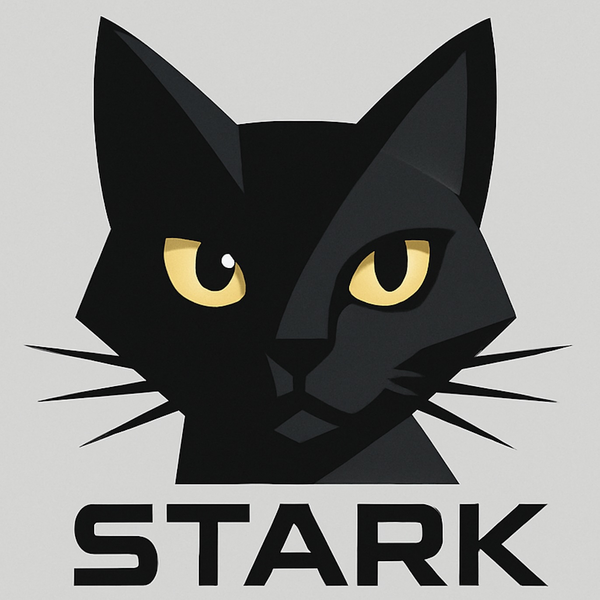

<p align="center">
  
</p>

<h1 align="center">Stark</h1>

<p align="center">
  <strong>Native inference on Apple silicon.</strong><br>
  Rust and Metal for local generation, probability scoring and model preparation.
</p>

<p align="center">
  <a href="#quickstart">Get started</a> ·
  <a href="#supported-model-families">Models</a> ·
  <a href="#measured-performance">Benchmarks</a> ·
  <a href="#developing-stark">Developers</a> ·
  <a href="docs/README.md">Documentation</a> ·
  <a href="https://starkengine.app/">Website</a>
</p>

Stark is an experimental, open-source Rust/Metal engine for running language models locally on Apple silicon. It provides a menu bar app, terminal chat, a loopback OpenAI-style API, probability scoring and model conversion. Applications can also drive its native workers directly through private stdin/stdout pipes with one JSON request and reply per line.

| Generate | Score | Prepare |
| --- | --- | --- |
| Terminal chat and native text generation with fresh state per request. | Candidate logits, full-vocabulary log probabilities and temperature-scaled candidate probabilities. | Streaming conversion of supported dense and existing MLX 4/8-bit checkpoints. |
| [Generation protocol](docs/GENERATION.md) | [Scoring protocol](docs/SCORING.md) | [Converter guide](tools/converter/README.md) |

## Quickstart

Use an **Apple silicon Mac with macOS 26.4 or newer** in a native arm64 terminal. The [latest signed release](https://github.com/jshahbazi/stark/releases/latest) includes the menu bar app, terminal chat, both workers, the converter and private Python runtimes; no source checkout or developer tools are needed.

### Install the app

Download the signed, notarized `.dmg` from the [latest release](https://github.com/jshahbazi/stark/releases/latest) and open **Install Stark** when included. It replaces the running copy and launches the new app. Older DMGs use drag-and-drop: copy `Stark.app` into Applications, quit the old app, then open the installed copy. Click the cat icon and choose **Manage Models**. Use **Model Catalog** or **Add from Source** to add a model, choose **Run** in **Installed**, then **Open Playground** to chat. [Menu bar guide](apps/menu-bar/README.md)

### Install the app and terminal tools

```sh
curl -fL https://github.com/jshahbazi/stark/releases/latest/download/install.sh -o stark-install.sh
sh stark-install.sh
export PATH="$HOME/.local/bin:$PATH"
stark doctor
open "$HOME/Applications/Stark.app"
```

The script installs the CLI under `~/.local` and the app under `~/Applications` without sudo and checks the archive checksum before activating anything. Add the `PATH` line to `~/.zprofile` to keep `stark` available. The DMG and the in-app updater verify code signatures; the script checks a checksum from the same release. See [installation](docs/INSTALLATION.md), including [what each route verifies](docs/INSTALLATION.md#what-each-install-route-verifies).

### Chat in Terminal

```sh
stark convert Qwen/Qwen3-0.6B --output models/qwen3
stark chat --model-path "$PWD/models/qwen3"
```

Conversion downloads the model; use a new output directory each time. Chat loads it: one message per line, `/reset` clears history, `/exit` quits. See [chat options](docs/GENERATION.md#interactive-cli-chat).

### Use Stark from another app

Stark serves an OpenAI-style chat API for clients on the same Mac. Run a model, open **Connection Details** from Stark's menu, and paste the **Base URL**, **API key** and **Model ID** into the client's OpenAI-compatible provider settings. The key changes on every launch. Browser-origin requests, remote devices, tool calls, embeddings and structured output are unsupported. See the [local API contract](docs/LOCAL_API.md) and [tested clients](docs/LOCAL_API.md#client-compatibility).

The [native image path](docs/MULTIMODAL_IMPLEMENTATION.md) accepts one PNG/JPEG through the CLI, Local API, and Swift attachments. Compatible dense Qwen3.5 BF16 models and merged fine-tunes use the [configuration-driven family contract](docs/VISION_FAMILY_CONTRACT.md), with automatic local checks before image input is enabled. Reference qualification is separately recorded for an exact 0.8B artifact, worker, device and macOS tuple. The app supports attachment selection, drop, paste, preview, removal, and image conversations.

## Models and application integration

### Supported model families

| Path | Implemented families | Scope |
| --- | --- | --- |
| Text conversion | Qwen2, Qwen3 dense, Qwen3.5 dense, Llama, Mistral, Gemma 2, Gemma 3 text, Phi-3, Granite, SmolLM3, LFM2, LLaMBA | Supported Safetensors configurations and tensor layouts; selected families also accept existing MLX affine 4/8-bit weights. |
| Native original-format execution | GLM-5.3-Flash, Qwen3.8-Flash-Next, Recursive Flint | Separate Rust/Metal paths with [pinned GGUF or MLX checkpoints and preparation commands](docs/NATIVE_HYBRID_MODELS.md). See [Flint setup and limits](docs/FLINT.md). |
| Image input | Qwen3.5 dense BF16 | Compatible models and merged fine-tunes require reviewed processing metadata and automatic local image checks. |
| Classifier conversion | ModernBERT | Classifier artifacts only; the app has no ModernBERT chat, Decision or image workflow. |

Family support describes implemented code paths. Each checkpoint needs compatible metadata and tensors and a successful native load; quality, throughput and Decision calibration require separate validation. These are source-tree capabilities; installed releases may contain an earlier set of families.

The [converter guide](tools/converter/README.md#catalog-coverage-and-qualification) details formats and checkpoint coverage. Existing supported MLX 4/8-bit weights are repacked without requantization. For a complete downloaded or merged fine-tuned checkpoint:

```sh
stark convert /absolute/path/to/checkpoint --metadata-profile hf-generic \
  --offline --output models/local-model
```

The folder needs complete safetensors weights, config, tokenizer, chat template and end-of-sequence metadata; merge LoRA/PEFT adapters first. A successful conversion checks the layout, not inference quality. See [future checkpoints](tools/converter/README.md#future-checkpoints-and-architecture-tracking).

Application authors can drive a worker directly:

| Task | Command |
| --- | --- |
| Generate text | `stark generate --model-path /absolute/path/to/converted-model` |
| Score candidates | `stark score --score-model-path /absolute/path/to/converted-model` |

Both wait for JSON-lines requests. The application renders the chat template and owns tools and the agent loop. See [worker protocols](docs/WORKER_PROTOCOLS.md). Host integrations belong in separate repositories.

## Developing Stark

Read [CONTRIBUTING.md](CONTRIBUTING.md) and [AGENTS.md](AGENTS.md) before changing code. Source builds need Xcode's Metal Toolchain, rustup and uv; commands run from the repository root with Rust **1.98.1**, uv **0.12.24** and locked dependencies.

| Area | Code and guide |
| --- | --- |
| Engine and Metal kernels | `crates/stark-engine/`; [technical guide](docs/TECHNICAL_OVERVIEW.md) |
| Generation and scoring workers | `crates/stark-generate/`, `crates/stark-score/`; [worker protocols](docs/WORKER_PROTOCOLS.md) |
| Converter, chat, local API and app backend | `tools/converter/stark_convert/`; [converter guide](tools/converter/README.md), [local API](docs/LOCAL_API.md) |
| Menu bar app | `apps/menu-bar/`; [build and usage](apps/menu-bar/README.md) |
| CLI launcher, installer, release | `scripts/stark`, `install.sh`, `scripts/`; [installation](docs/INSTALLATION.md), [releasing](docs/RELEASING.md) |
| Checks and validation | [CI](docs/CI.md), [validation records](docs/validation/), [benchmarks](docs/benchmarks/README.md) |
| Website | `website/`; [setup and publishing](website/README.md) |

Build the workers with `cargo +1.98.1 build --release --locked -p stark-generate` and, separately, `cargo +1.98.1 build --release --locked -p stark-score --features optimized`. For checkout chat use `./scripts/stark chat --model-path /absolute/path/to/converted-model`. Start with the repository policy check, then the [checks for the area you changed](docs/CI.md#local-checks):

```sh
uv run --locked --python 3.12.13 --script scripts/ci/check_repository.py
```

The inherited Uzu bindings, server and command-line crates have been removed (see [upstream provenance](provenance/UPSTREAM.md#removed-inherited-code)); the inherited cloud, signing and release workflows stay disabled.

## Measured performance

Qwen3.5-2B (4-bit), Apple M5 Max (40 GPU cores, 128 GiB), one request at a time, measured 2026-10-22:

| Engine | Build / version | End-to-end tokens/s |
| --- | --- | ---: |
| Stark | `97f15f38` | **245.5** |
| MLX-LM | `72be8c955` / MLX 0.32.4 | 218.8 |
| vLLM Metal | 0.32.0 | 174.7 |
| llama.cpp | b11747 | 147.9 |
| TensorFold (drafting on) | 1.1.1 | 125.6 |
| TensorFold (drafting off) | 1.1.1 | 118.5 |

Stark led all six workloads with 12.2% higher aggregate throughput than MLX-LM. Rates include input processing, generation, transport and cleanup, and exclude loading and warmup; the aggregate is the geometric mean of six workload rates from four loads and three repeats each. Results vary with system load, model and hardware, and apply to the recorded builds. [Interactive comparison](https://starkengine.app/#benchmarks) · [Method and versions](docs/benchmarks/QWEN35_ENGINE_COMPARISON_2026_10_22.md) · [All benchmarks](docs/benchmarks/README.md) · [Conversion benchmarks](docs/benchmarks/CONVERSION_BENCHMARKS.md)

## Project and provenance

Stark is a standalone fork of [Uzu](https://github.com/trymirai/uzu) starting at Uzu 0.6.1 (`8d01581474760bd1fc7f4a547ff1d02f7dada437`). Upstream Git history, copyright, MIT licensing and Mirai attribution are preserved. See [security policy](SECURITY.md), [upstream provenance](provenance/UPSTREAM.md) and [LICENSE](LICENSE).
