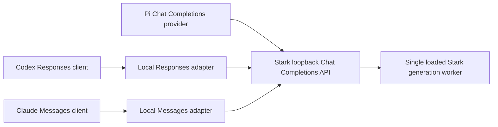

# Codex, Claude and Pi integration plan

Status: proposed implementation and qualification plan, reviewed against Stark
`main` revision `a171326271f6c5eaf31f4ea49bc21905f7e7a813` on 2026-11-12.
This document adds no runtime support. No Codex, Claude or Pi session was run
against Stark for this work. Configuration examples below are proposed starting
points; examples involving an adapter require that adapter to be implemented.

## Objective and delivery order

Let a coding client use a model loaded in Stark for inference while the client
continues to own its workspace, tools, execution permissions and conversation.
Qualify each client version, model artifact and backend independently.

| Client surface | Protocol to Stark or adapter | Work required | Initial release gate |
| --- | --- | --- | --- |
| Pi terminal | OpenAI Chat Completions | Provider configuration; optionally a discovery/authentication extension | Actual Pi tool loop, streaming and cancellation pass |
| Codex CLI | OpenAI Responses | Local protocol adapter and Codex model catalog | Responses contract and actual CLI tool loop pass |
| Codex desktop | OpenAI Responses | Same adapter plus desktop configuration and model-selection qualification | Fresh desktop chat uses the intended provider and model |
| Claude Code CLI | Anthropic Messages | Local protocol adapter and conservative capability configuration | Experimental compatibility; actual CLI tool loop passes |
| Claude desktop Code surface | Anthropic Messages gateway | Same Messages adapter plus desktop-specific third-party inference setup | Separate desktop qualification and confirmed gateway access |

Implement Pi first, then Codex, then the experimental Claude path. Establish
manual, explicit credentials before adding a managed Connect/Disconnect flow.
Anthropic explicitly does not support routing Claude Code to non-Claude models
through a gateway. A successful local test would establish a bounded Stark
compatibility result, with that support limitation retained. See the official
[Claude gateway overview](https://code.claude.com/docs/en/llm-gateway).

Here, “Claude” covers Claude Code and the desktop Code surface. Replacing the
model used by ordinary Claude chat, Cowork, web or mobile is outside this plan.
An MCP server exposing Stark as a tool is a separate integration: it does not
make Stark the coding client's inference provider.

## Current Stark contract

The owning reference is [Local API](LOCAL_API.md). Recheck it and the source
before implementing against a later revision.

| Area | Current behavior | Integration consequence |
| --- | --- | --- |
| Transport | Loopback HTTP; validates Host; rejects browser Origin requests | Run clients/adapters on the same host; do not expose a LAN listener or enable browser access |
| Authentication | Bearer key from Connections; master key stored in macOS Keychain | Obtain credentials through the supported user flow; never embed them in examples or checked-in configuration |
| Endpoints | `GET /health`, `/v1/health`, `/v1/capabilities`, `/v1/models`, `/v1/models/{id}`; `POST /v1/chat/completions` | Responses and Messages need external adapters |
| Model selection | Public API model ID identifies the loaded model in Chat mode | Do not use private library IDs or silently route an unavailable ID to another model |
| Model metadata | HTTP model entry includes API context/output limits, tool support and MTP capability/default data | Use the HTTP API ceiling, not a native worker limit; reject unknown limits for a managed catalog |
| Request validation | Unknown fields fail; `store` must be omitted, false or null; token-limit aliases cannot both be present | Normalize explicitly; report unsupported semantic fields before generation |
| Roles and options | `developer` becomes `system`; template-specific thinking/reasoning options | Do not assume a model supports OpenAI or Claude reasoning controls |
| Streaming | Chat chunks, terminal finish reason, optional usage-only chunk, then `[DONE]` | Translate both completion and failure paths; an early EOF is not success |
| Tools | Supported template/parser required; at most 64 definitions and 16 calls; `strict: true` rejected | Validate arguments in the client; schema-constrained generation is not implemented |
| Scheduling | One active completion, eight queued; queue timeout and connection limits apply | Bound retries and client fan-out; concurrent agents do not imply parallel inference |
| Lifecycle | Disconnect cancels generation; model changes fail active/waiting requests | Propagate aborts and invalidate stale model metadata |

Read the implementation at
[`api_request.py`](../tools/converter/stark_convert/api_request.py),
[`api_tools.py`](../tools/converter/stark_convert/api_tools.py),
[`local_api.py`](../tools/converter/stark_convert/local_api.py) and
[`desktop.py`](../tools/converter/stark_convert/desktop.py).
The [tool coverage](TOOL_CALLING.md) and [model onboarding](MODEL_ONBOARDING.md)
pages define the model-specific work behind an advertised capability.

### Existing OpenWork/OpenCode connection

The managed connector lives in the separate `stark-openwork` repository. It
uses a private Unix socket, verified client identity, approval, and renewable
120-second bearer capabilities. The present broker recognizes specific
OpenWork/OpenCode processes. It does not authorize Codex, Claude, Pi or a new
adapter merely because they know its socket path.

Process verification gates capability issuance. The issued HTTP bearer is
transferable if exposed. Lease expiry does not cancel a stream already admitted;
explicit revocation does. Preserve these distinctions when designing new grants.
See [Contributing](../CONTRIBUTING.md#openwork-managed-connection) and the
[managed connection reference](LOCAL_API.md#managed-openwork-connection).

## Architecture and repository ownership

Keep host integration in a separate repository, as required by
[AGENTS.md](../AGENTS.md). The names below are proposed responsibilities, not
existing packages, commands or approved distribution infrastructure.



| Owner | Responsibility |
| --- | --- |
| Separate integration repository | Responses/Messages HTTP routes; protocol translation; Pi extension; client config generation; versioned contract tests; adapter lifecycle |
| Stark repository | Existing engine/API contract; a separately scoped change for any new capability-grant or tokenizer API needed by adapters |
| Coding client | Conversation persistence, workspace access, argument validation, execution permissions, tool execution and display |

Prefer one shared adapter implementation with separate protocol frontends.
Use Stark's existing HTTP API as the initial backend. Do not import private
Python app internals, launch a second generation worker, or duplicate model
templates in the adapter. Keep packaging and signing work separately scoped.

### Shared adapter requirements

1. Bind to an explicit loopback address and configured port. Fail on a port
   conflict. Advertise the resolved address; never silently choose another port.
2. Authenticate every inference and catalog request. Use distinct client-facing
   credentials and an upstream Stark credential; never return the upstream key
   to the client. Validate Host and reject browser-origin access.
3. Resolve a fixed public model ID against the running Stark instance. Snapshot
   the admitted model and capabilities. A model switch must invalidate pending
   work and catalogs rather than substitute another artifact.
4. Convert each full conversation to a canonical internal representation:
   ordered system/user/assistant content, typed tool calls, matching tool
   results, generation options and an authenticated request owner.
5. Use an explicit translation table for each protocol field. Ignore only
   documented nonsemantic hints. Reject unsupported behavior with a compatible
   error; never discard an instruction, tool result, image or capability request
   just to make a request pass.
6. Forward a single streaming completion to Stark. Preserve backpressure with
   bounded buffers. Do not collect the entire generated answer before streaming.
   Generate heartbeat comments or protocol pings during long prefill without
   claiming model progress or renewing Stark's own execution deadline.
7. Cancel the upstream HTTP request when the downstream client disconnects.
   Prevent automatic retries after any generated output has been delivered.
   Retry before output only for explicitly retryable conditions, with a bound.
8. Return synthetic public request IDs and scrubbed errors. Logs may contain
   aggregate timings, counts, status classes, versions and artifact hashes.
   Never log payloads, prompts, responses, token vectors, credentials or raw
   exception dumps. Keep any private qualification material out of Git.

The current Chat representation may not express every interleaving of text and
typed tool blocks in Responses/Messages. Inventory this before claiming a
lossless bridge. Initially qualify text followed by terminal tool calls; reject
history shapes whose order cannot be preserved. Extending Stark's public
content contract is a separate prerequisite for richer block sequences.

### Session isolation and prefix reuse

Stark scopes retained generation state by the API session and authenticated
principal. All master-key requests share a key-wide scope; managed client grants
have client-ID scopes. `user` and `metadata` are accepted and discarded and do
not create session boundaries. A new adapter's client-facing session ID cannot
change that upstream behavior.

The manual pilot must disclose that an adapter using one master key shares that
upstream scope across its trusted sessions. It must not claim per-session cache
isolation. Do not invent a session header or set `metadata` and call the problem
solved. If separate upstream scope is an acceptance requirement, block that
rollout until Stark has a reviewed, authenticated grant/scope API.

For a managed release, propose per-client-instance grants with an appropriate
conversation scope and explicit revocation. Verify caller identity using a
reviewed mechanism for each actual runtime: terminal Pi, a helper process and a
signed desktop app do not have interchangeable identities. Never reuse an
OpenWork client ID, approval, process-name allowlist or signature assumption.

Preserve Stark's single immediately preceding reusable text prefix, context
size, model instance, host scope, MTP/state options, recurrent snapshots and
invalidation rules. Do not persist native state or add a multi-session cache.
Interleaved callers can evict that one entry. Native cache reuse is independent
of any vendor `store`, cache-control marker or Pi cache-warming option. Count a
cache hit only from actual upstream usage evidence. See
[prefix reuse](LOCAL_API.md#prefix-reuse).

## Pi: direct Chat Completions integration

Pi supports compatible endpoints through `models.json`; executable provider
extensions are available for discovery and custom authentication. This permits
a direct manual pilot using Stark's current API. Official references:
[choose a model](https://pi.dev/docs/latest/models),
[configuration location](https://pi.dev/docs/latest/configuration) and
[provider extensions](https://pi.dev/docs/latest/custom-provider).

### Manual setup

1. Start the intended model in Stark's Chat mode and enable the local API through
   Connections. Obtain the displayed Base URL and key through Stark's user flow.
2. Inspect authenticated `/v1/models` and `/v1/capabilities` without writing
   credentials or response payloads to logs. Record the public model ID, finite
   context capacity, API `max_output_tokens` ceiling and tool capability for
   configuration. Native worker output limits are a different contract.
3. Merge a new provider entry into `~/.pi/agent/models.json`, preserving other
   providers. The following valid JSON is a template: replace the port, model ID,
   display name and numeric limits before using it. `32768` and `2048` are
   illustrative limits, not claims about the loaded artifact.

```json
{
  "$schema": "https://pi.dev/schemas/models.schema.json",
  "providers": {
    "stark-local": {
      "name": "Stark local",
      "baseUrl": "http://127.0.0.1:PORT/v1",
      "api": "openai-completions",
      "apiKey": "${STARK_API_KEY}",
      "authHeader": true,
      "compat": {
        "supportsStore": false,
        "supportsDeveloperRole": false,
        "supportsReasoningEffort": false,
        "supportsStrictMode": false,
        "supportsUsageInStreaming": true,
        "maxTokensField": "max_tokens"
      },
      "models": [
        {
          "id": "MODEL_ID_FROM_STARK",
          "name": "Stark running model",
          "reasoning": false,
          "input": ["text"],
          "cost": { "input": 0, "output": 0, "cacheRead": 0, "cacheWrite": 0 },
          "contextWindow": 32768,
          "maxTokens": 2048
        }
      ]
    }
  }
}
```

4. Supply `STARK_API_KEY` privately to the Pi process. Do not paste the key into
   shell history, command arguments or the shared configuration. Zero costs
   describe local API billing metadata; they do not assert zero hardware cost.
5. Open `/model` to reload the configuration and select `stark-local` and the
   running model. In a shell with the credential already available, the explicit
   CLI selection is:

```sh
pi --provider stark-local --model 'MODEL_ID_FROM_STARK'
```

6. Run the acceptance sequence below in a disposable workspace before granting
   access to a real project. A provider appearing in the picker is insufficient.

The explicit compatibility settings avoid relying on localhost URL heuristics.
Stark normalizes incoming developer messages to system. With the initial
profile, Pi sends system messages directly and does not request reasoning
effort or strict tools. `reasoning: false` is
client metadata; it does not prove a template cannot generate internal thinking.
Do not send a thinking override unless the specific Stark template supports it.
Field semantics are defined in Pi's
[models reference](https://pi.dev/docs/latest/models-configuration).

### Managed Pi extension

After the manual pilot passes, build a provider extension in the integration
repository. Register a distinct Stark provider through Pi's public provider API
and delegate generation to its existing Chat Completions implementation.

- Discover the running model and refresh finite limits/capabilities when the
  model changes. Publish only tool/image capabilities actually qualified for
  that artifact. Handle unavailable models explicitly.
- Pin one public provider API form. A legacy `ProviderConfig.refreshModels`
  returns definitions; a complete provider refresh publishes its model update.
  Pass the supplied abort signal to discovery requests and keep live-only
  metadata nonpersistent unless an explicit snapshot policy requires it.
- Resolve credentials at request time through the reviewed Stark grant flow.
  Keep short-lived capabilities in memory. Honor refresh cancellation and avoid
  persisting credentials through catalog snapshots or Pi's auth store.
- Keep a static `models.json` fallback for users who choose manual key handling.
  Pi supports environment interpolation and command resolution for keys, but a
  credential command is not automatically a managed, identity-bound connection.
- Merge only Stark-owned configuration, detect conflicts, and remove only owned
  entries on disconnect. Revoke grants and cancel admitted work at Stark.
- Leave cache-warming metadata unset initially. Validate prefix reuse through
  actual Stark counters rather than adding idle requests to maintain it.

Use the extension API/schema of the pinned Pi release and test both reload and
full restart. An extension that can access credentials and payloads is trusted
code; do not add request-inspection logging.

## Codex: Responses adapter

Codex custom providers currently use `wire_api = "responses"`. Configure an
adapter endpoint rather than pointing Codex directly at Stark's Chat
Completions listener. Use the installed client's matching model-catalog schema
and test CLI and desktop separately. See
[Codex provider configuration](https://learn.chatgpt.com/docs/config-file/config-reference).

### Request translation

Serve `POST /v1/responses` in the external adapter. Support streaming first and
buffered responses for contract tests. Start with stateless full-history
requests and `store: false`. Reject non-null `previous_response_id`, persistent
conversation references, background jobs and retrieval/cancel endpoints until
their state and lifetime contracts are implemented. HTTP disconnect handles
foreground cancellation.

| Responses input | Adapter action |
| --- | --- |
| `model` | Validate exact advertised Stark model ID |
| `instructions` plus ordered message items | Build the system/instruction and conversation sequence without losing role or content ordering |
| String `input` or typed text message content | Normalize to Stark message text |
| Assistant `function_call` | Convert to a Chat tool call; preserve `call_id`, function name and arguments |
| `function_call_output` | Convert to the matching tool-result message; reject missing, duplicate or mismatched call IDs |
| Function tool definition | Convert the flat Responses function definition to Stark's function-tool envelope |
| `tool_choice`, `parallel_tool_calls` | Map auto/none/required/named modes; enforce Stark's limits |
| `max_output_tokens` | Convert to one Stark token-limit field and enforce actual capacity |
| Sampling fields | Forward only supported equivalents; preserve defaults deliberately |
| Reasoning, verbosity, structured output, strict/custom/hosted tools | Support only a verified mapping; otherwise reject and adjust the client capability profile |

An image input or image tool result remains unsupported in the initial
text-only profile. A later image profile needs the existing Stark image
admission path and artifact-specific qualification; do not flatten images to
text. Treat unsupported file/audio or encrypted reasoning items similarly.
Opaque reasoning replay must not be silently discarded.

Use the current
[Responses request reference](https://developers.openai.com/api/reference/resources/responses/methods/create)
for wire shapes. The table is an implementation proposal, not a claim that
Chat Completions and Responses are equivalent.

### Tool and strict-schema blockers

Stark currently supports ordinary function tools with schema hints. Codex may
send free-form tools, grammar-based patch tools, namespaces or strict function
schemas depending on its version and model profile. Inventory the actual tool
declarations using synthetic, private contract fixtures.

Prefer a supported client profile that emits ordinary function tools. If that
profile is unavailable, either implement a narrowly specified tool-shape bridge
with round-trip tests, or record the client version as blocked. The adapter
must not execute tools itself. A strict schema request cannot be made truthful
by removing `strict: true`. Reject it until constrained generation or a
documented validation/retry contract provides the promised behavior. Configure
capabilities honestly, then verify what the installed client actually sends.
The [OpenAI function-calling guide](https://developers.openai.com/api/docs/guides/function-calling)
defines the function-call/result exchange and strict schema contract.

### Response and SSE translation

Generate stable response/item IDs and associate each tool call with a distinct
call ID. Preserve output order. The expected successful sequence is:

1. `response.created`, followed by `response.in_progress` where required by the
   pinned client contract.
2. For text: `response.output_item.added`, `response.content_part.added`, zero or
   more `response.output_text.delta`, then text/part/item completion events.
3. For each tool call: add a `function_call` output item, emit
   `response.function_call_arguments.delta`, then arguments/item completion.
   Stark can deliver tool calls after parsing the generated output; emitting one
   complete argument delta at that point is preferable to inventing partial
   tool progress. Never expose an unvalidated call for execution.
4. Finish with `response.completed`, or the documented incomplete/failure event
   and object. A token limit must remain an incomplete result. No completion
   event is emitted after an upstream error or missing terminal chunk.

Maintain required event names, indexes, item IDs and sequence numbers for the
pinned protocol. Do not reuse Chat Completions `[DONE]` as a substitute for the
Responses terminal event. Map prompt/completion/total usage to input/output/total
usage and actual cached-token detail. Do not invent reasoning-token accounting.
Validate emitted events using the client's parser and the
[streaming reference](https://developers.openai.com/api/docs/guides/streaming-responses).

### Proposed Codex configuration

The following TOML requires a functioning adapter. Replace `17891`, model ID,
catalog path and numeric limits with the actual deployment values. Keep the
top-level keys before the first table. Merge this into user-level configuration;
do not rely on provider definitions in project-local configuration.

```toml
model = "MODEL_ID_FROM_STARK"
model_provider = "stark-local"
model_catalog_json = "/absolute/path/to/stark-codex-models.json"
model_context_window = 32768
model_auto_compact_token_limit = 24576
web_search = "disabled"

[model_providers.stark-local]
name = "Stark local"
base_url = "http://127.0.0.1:17891/v1"
wire_api = "responses"
env_key = "STARK_ADAPTER_KEY"
requires_openai_auth = false
supports_websockets = false
supports_standalone_web_search = false

[model_providers.stark-local.capabilities]
remote_compaction = "unsupported"
```

Use a client-version-matched catalog entry for this custom model. Define its
slug, instructions, finite context window, truncation budget, output limit and
qualified tool profile. Start with ordinary shell/function tools and no
advertised reasoning, verbosity, image or hosted-tool capabilities. Validate
the schema against the installed Codex release; do not impersonate a cloud
model or inherit its unverified capabilities.

A local `model_catalog_json` replaces the bundled catalog. For managed setup,
serve a separate authenticated Codex catalog URL in the adapter and configure
`model_catalog_url`; remove the local override when switching. Stark's ordinary
`/v1/models` listing is not a Codex catalog. See the official
[catalog rollout guide](https://learn.chatgpt.com/docs/enterprise/roll-out-a-gateway).

The initial credential is the adapter's client-facing key supplied privately
to the Codex process. For a managed helper, use Codex's command-backed auth
contract instead of `env_key`: stdout must contain only the token, with bounded
refresh and no logging. Do not combine incompatible authentication settings.
The helper still needs a new, reviewed Stark authorization mechanism.
See [advanced configuration](https://learn.chatgpt.com/docs/config-file/config-advanced).

Restart Codex after changing a catalog/provider. In desktop, create a fresh
local chat and verify provider, model and tools; do not assume an existing
cloud-backed chat migrated. A desktop process launched outside the shell may
not inherit environment credentials. CLI success does not qualify the desktop
picker, reconnection or credential delivery. Cloud sessions cannot reach a
loopback adapter on the user's Mac.

## Claude: experimental Messages adapter

The adapter must serve `POST /v1/messages`, including the `?beta=true` form
used by Claude Code. Route by path. Its best-effort `HEAD /api/hello` warmup
probe may be answered or rejected without admitting inference. Token counting
and model discovery can be added separately.
Use the Anthropic Messages format; OpenAI Chat Completions is not accepted as
its wire replacement. Current gateway requirements are documented in the
[Claude Code compatibility guide](https://code.claude.com/docs/en/llm-gateway-protocol).

### Messages and tool translation

| Anthropic input/output | Proposed mapping |
| --- | --- |
| Top-level `system` string or text-block array | Leading Stark system content; preserve block order and text |
| User/assistant text blocks | Ordered Chat message text; do not merge across tool boundaries |
| Assistant `tool_use` with `id`, `name`, object `input` | Chat tool call with the same correlation ID and serialized arguments |
| User `tool_result` with `tool_use_id` | Corresponding Chat tool-result message; preserve result text and explicit error indication |
| Tool `input_schema` | Function parameters schema; preserve descriptions and required fields |
| `tool_choice`: auto/none/any/tool | Stark auto/none/required/named modes |
| `disable_parallel_tool_use` | Map the nested tool-choice option to Stark's parallel-tool boolean and enforce the requested call count |
| `max_tokens`, sampling and stop sequences | Forward supported equivalents with validated bounds |
| Images, documents, server tools, thinking signatures and context-management directives | Reject in initial profile unless a complete, qualified mapping exists |

Split mixed user content into the required Chat message sequence while
preserving which tool result each block belongs to. Tool results with nested
images require a separate image-qualified mapping. Do not stringify unsupported
blocks and thereby erase their type or execution meaning. The client remains
responsible for running tools and validating input. Under disabled parallel use,
`auto` permits at most one call, while `any` or a named tool requires one. Verify
the result against that contract before returning it. Reject malformed or
non-object tool input instead of emitting an executable `tool_use` block.

The response is a Messages object with `type: "message"`, assistant role,
actual model ID, ordered content blocks, stop reason, nullable stop sequence and
usage. Map native end-of-turn to `end_turn`, a tool handoff to `tool_use`, and
Stark `length` to `max_tokens`. Stark's `length` can mean output exhaustion or a
context boundary; it does not distinguish the cause. Preserve that limitation
in adapter diagnostics and context-recovery tests. Map a known matching stop
sequence to `stop_sequence`. Do not claim the matched sequence if upstream does not identify
it; close that gap before enabling the option. See the
[Messages API](https://platform.claude.com/docs/en/api/messages) and
[tool-use reference](https://platform.claude.com/docs/en/agents-and-tools/tool-use/overview).

### Messages streaming

Implement the documented SSE state machine:

1. `message_start`, with empty content and available initial usage.
2. Each block has `content_block_start`, optional `content_block_delta` events,
   and `content_block_stop`, with consistent indexes.
3. Text deltas use `text_delta`. Tool argument deltas use `input_json_delta`
   and `partial_json`; the completed tool input must be a valid object.
4. `message_delta` carries the stop reason and cumulative output usage, followed
   by `message_stop`. Emit periodic `ping` events during long prefill pauses.
5. A midstream failure emits a compatible `error` event and terminates without
   a false successful ending. Closing the downstream connection cancels the
   Stark request; this cancellation propagation is an adapter requirement.

Do not manufacture `thinking_delta`, `signature_delta` or redacted-thinking
blocks. A local model's visible reasoning text is not an Anthropic signature.
The initial profile requests no extended/adaptive thinking. If the client still
requires it, fail with a capability error and record the profile as blocked.
Reference: [Anthropic streaming](https://platform.claude.com/docs/en/build-with-claude/streaming).

### Errors, token counting and beta features

Use Anthropic-shaped errors and a `request-id` response header. Distinguish invalid input,
authentication, permission, unavailable model, request size, queue overload,
timeout and native-generation failures. Map retryable conditions deliberately;
avoid error text that falsely triggers context compaction or unsupported-feature
fallback. `Retry-After` uses bounded integer seconds. No error body may contain
private upstream payloads or exception dumps. Reference:
[Anthropic errors](https://platform.claude.com/docs/en/api/errors). Model-free
tests should check at least 400/`invalid_request_error`,
401/`authentication_error`, 403/`permission_error`, 413/`request_too_large`,
429/`rate_limit_error`, 500/`api_error` and 504/`timeout_error`. Do not manufacture
cloud billing errors for a local queue failure.

Initially omit `/v1/messages/count_tokens`: Claude Code can fall back to its
context estimate. An accurate implementation needs Stark's actual tokenizer
and rendered template, including tools and applicable image accounting. That
requires a separately scoped public API or a pinned equivalent tokenizer/render
contract. Do not import private app internals or return Claude-token estimates
as exact Stark counts. Return `{ "input_tokens": ... }` only when that semantic
contract is met. Reference:
[token counting](https://platform.claude.com/docs/en/api/messages/count_tokens).

Record incoming beta names and fields as a synthetic compatibility inventory.
The local adapter terminates the Anthropic protocol, so it must implement,
negotiate or reject requested semantics. General gateway advice to forward
headers unchanged applies to an Anthropic upstream; it cannot make a local
Stark model implement adaptive reasoning, tool search or server-side context
editing. Disable experimental client features for the initial pilot, and test
what stable fields remain. That setting does not remove all beta headers,
thinking assumptions or tool-search behavior in every host/version. Never
silently discard behavior-changing fields.

### Proposed Claude Code CLI setup

These variables require the implemented Messages adapter. `17892` is an
illustrative adapter port; the base URL has no trailing `/v1` because the client
adds the Messages path. Provide `STARK_ADAPTER_KEY` privately beforehand.

```sh
export ANTHROPIC_BASE_URL='http://127.0.0.1:17892'
export ANTHROPIC_AUTH_TOKEN="$STARK_ADAPTER_KEY"
export ANTHROPIC_DEFAULT_HAIKU_MODEL='MODEL_ID_FROM_STARK'
export ANTHROPIC_DEFAULT_SONNET_MODEL='MODEL_ID_FROM_STARK'
export ANTHROPIC_DEFAULT_OPUS_MODEL='MODEL_ID_FROM_STARK'
export CLAUDE_CODE_DISABLE_EXPERIMENTAL_BETAS=1
claude --model 'MODEL_ID_FROM_STARK'
```

Use a clean test process without competing Anthropic API-key/helper credentials.
Pin model aliases and reject unknown routes so auxiliary requests cannot
silently select a cloud model. Correct the assumed context window for the custom model using
the pinned Claude Code release's supported model configuration. Unknown model
IDs can inherit capabilities that Stark lacks; if those cannot be disabled or
truthfully represented, that release remains blocked. The adapter must reject
unknown model routes rather than fall back to a network provider.

Run `/status` and a synthetic tool loop, then verify local routing from
scrubbed adapter counters. A custom inference URL does not prove all client
traffic stays local: ancillary client features can contact Anthropic directly.
Review network behavior before making an offline claim. Configuration and
surface distinctions are in the
[Claude connection guide](https://code.claude.com/docs/en/llm-gateway-connect).

### Claude desktop setup

Desktop uses third-party inference configuration rather than the CLI
environment variables above. Follow the official
[desktop gateway configuration](https://claude.com/docs/third-party/claude-desktop/gateway)
for the installed release and account. Configure the local adapter URL and a
supported private credential method; respect any managed configuration.

Establish that this particular desktop/account deployment permits the required
gateway configuration before implementing a one-click setup. Where the local
configuration form is available, enable Developer Mode under Help's
Troubleshooting menu, then open Developer's Configure Third-Party Inference
form. Managed configuration takes precedence. Verify these labels against the
installed release. Do not patch the
app, spoof enrollment, claim ordinary chat support, or assume an identity
provider is required for a standalone CLI pilot. Localhost from an SSH host,
container or cloud session refers to that environment, so those are separate
networking scopes and excluded from the first local release.

Qualify a fresh Code session, model selection, auth, tools, restart, disconnect
and model changes separately. Retain the non-Claude support limitation in UI
and documentation even if all bounded desktop checks pass.

## Configuration, credentials and recovery

The manual phase uses only existing supported credential handling. A polished
managed connection is a later implementation with the following contract:

| Operation | Required behavior |
| --- | --- |
| Connect | Verify client/runtime identity; obtain explicit approval; install only Stark-owned public settings; keep keys/capabilities private |
| Refresh | Renew within a valid lease; honor cancellation; invalidate on API session change; never cache a failed credential indefinitely |
| Model/port change | Refresh public URL/catalog data; mark stale selections unavailable; require explicit repair where automatic reload is unsafe |
| Disconnect | Revoke the client's grants, cancel admitted requests and remove only recognized owned configuration |
| Adapter crash/restart | Close outstanding generation; discard in-memory credentials/state; require fresh upstream authentication |
| Partial installation | Atomically roll back only changes made by that operation; preserve unrelated JSON/JSONC/TOML entries and credentials |
| Conflicting configuration | Explain the conflict; do not overwrite an unrecognized provider, catalog or managed policy |

A credential supplied by shell environment is an explicit manual trust choice.
It does not have the nonpersistent capability properties of the existing
OpenWork connector. Document how the user can remove it and rotate the Stark
master key; rotation affects other manual key clients. For managed clients,
revocation must be scoped so disconnecting Pi cannot revoke Codex or OpenWork.

Keep adapter credentials distinct from Anthropic/OpenAI account credentials.
Never forward a cloud account token to Stark, place a Stark key in a public
catalog, expose a credential-print command in ordinary logs, or reuse a cached
capability across restart/session changes.

## Qualification and acceptance criteria

### Model-free protocol tests

Build synthetic upstream Chat Completions fixtures in the integration repository.
Pin client SDK/parser dependencies and record their licenses and source
revisions. Tests must exercise behavior rather than mirror helper functions.

| Case | Required result |
| --- | --- |
| Plain/empty/Unicode text | Correct text and event ordering across arbitrary transport chunk boundaries |
| Tool-only and text-plus-tool output | Valid IDs, tool input objects, ordered handoff and exactly one terminal outcome |
| Sequential and parallel tool results | Lossless replay; no duplicate execution or reordered correlation |
| Required/named/none tool choice | Correct enforcement or explicit unsupported result |
| Strict/free-form/hosted tools | Truthful rejection until an explicit capability is implemented |
| Unsupported input fields/blocks | Compatible error before upstream generation; no silent content loss |
| Length/stop/end-of-turn | Correct client-visible stop semantics and no success on truncation/error |
| Usage/cache counters | Whole input and output totals preserved; only measured cached tokens reported |
| Missing usage/EOF/malformed JSON | No invented accounting or successful terminal result |
| Slow prefill and backpressure | Responsive heartbeat, bounded memory, no premature retry |
| Disconnect/timeout/queue overload | Upstream cancellation and bounded recovery; model remains usable |
| Auth failure/refresh/revocation | No cross-client grants, persistent capability leaks or retry loops |
| Model change and stale catalog | Reject old route; no substitution or stale state reuse |
| Catalog/config collision | Preserve unrelated settings and validate against each pinned client schema |

Use the actual Responses/Messages parsers where available. Test split tool JSON,
multiple output items and errors after headers. Keep protocol tests independent
of expensive native inference and cloud credentials.

### Live client and artifact matrix

For each client surface, start in a disposable local repository with synthetic
files and a model that has supported function-tool parsing. Test:

1. Start from a fresh client session and confirm the provider/model route.
2. Stream a text answer and a follow-up using prior context.
3. Read a synthetic file, use the result, edit a file and inspect the diff.
4. Execute a harmless local test command under the client's configured
   permission policy; test a denied action if that policy supports denial.
5. Complete at least two sequential tool-result rounds and a failed-tool round.
6. Cancel during prefill and decode, then complete a recovery request.
7. Exercise context exhaustion/compaction, output truncation and an unavailable
   model. Confirm no cloud fallback or silent model substitution.
8. Restart Stark/client/adapter, switch models, change the port and disconnect.
9. Interleave separate sessions. Verify documented cache scope, exact-prefix
   reuse where available, and invalidation after cancellation/failure/restart.

Passing text chat does not qualify tool use. Passing one artifact does not
qualify another quantization or backend. Pi's permission behavior is its own
client policy; do not promise OpenWork's approval UI. A managed-auth result
must use the actual intended runtime and identity, without a test helper
standing in for the official client process.

### Evidence and performance

Record Stark base/implementation commits, adapter commit, client and bundled CLI
versions, OS/hardware, model/checkpoint revision, quantization and precision,
template/parser revision, executable hashes, context/output limits, MTP and
thinking options, and whether the run used manual or managed authentication.
Publish aggregate pass/fail counts, sanitized error classes and hashes only.
Keep any private native artifacts ignored.

Measure cold prefill, first text, follow-up first text, decode rate, tool-round
latency, adapter overhead and cancellation recovery with matched controls.
Separate reused-prefix runs from fresh runs and avoid interleaving other model
jobs. Protocol compatibility and throughput do not establish coding competence
or numerical equivalence. Report task success separately.

## Implementation milestones

| Milestone | Deliverable | Exit condition |
| --- | --- | --- |
| 0. Freeze contracts | Pin Stark/client versions; synthetic schemas and capability inventory | All unsupported fields and security boundaries have an explicit policy |
| 1. Pi manual pilot | Documented provider config and artifact-specific live checks | Pi text/tool/cancel/recovery matrix passes |
| 2. Shared adapter foundation | Loopback auth, model routing, canonical transcript, streaming and cancellation | Model-free contract and isolation tests pass |
| 3. Codex CLI | Responses frontend and version-matched catalog | Actual CLI tool flow passes; strict/custom-tool gaps resolved or blocked |
| 4. Codex desktop | Config delivery, picker and lifecycle support | Separate desktop acceptance passes |
| 5. Claude Code experimental | Messages frontend and conservative client profile | Tool flow passes without pretending to support reasoning or server tools |
| 6. Claude desktop experimental | Supported third-party inference setup | Account/surface access and separate local Code checks pass |
| 7. Managed connections | Reviewed Stark grant API, Pi extension, client helpers/installers | Issuance identity, renewal, revocation, cleanup and per-client isolation pass |

Each milestone should have its own reviewable implementation PR and evidence.
Client-specific work can proceed in parallel after the shared contract is fixed;
serialize model-bound qualification on this machine. No milestone inherits a
previous client's approval or artifact validation.

## Rollback and completion

For a manual pilot, stop the adapter, remove only the added provider entry and
catalog reference, unset the pilot environment variables, and restore the
previous explicit client selection. Rotate a master key only if exposure or
loss of control requires it. A managed rollback revokes its grants and removes
only recognized owned settings. Keep OpenWork/OpenCode working throughout.

An integration is complete only when its declared client surfaces, artifacts,
tool behavior, auth mode, cancellation, prefix-reuse policy and recovery cases
have matching evidence. Unsupported client versions remain explicitly blocked.
Update this plan and [Local API](LOCAL_API.md) as implementation lands; retain
dated validation separately under [archive/runs](archive/runs/) or in the owning
implementation PR. This documentation PR establishes the work required and
does not mark any runtime milestone complete.
